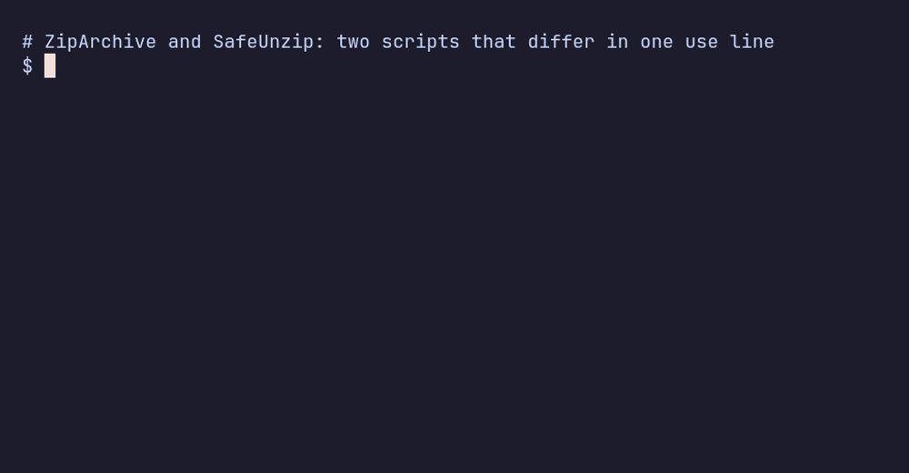

# SafeUnzip: safe ZIP extraction for PHP

[](https://github.com/sorge-it/safe-unzip/actions/workflows/tests.yml?query=branch%3Amain)
[](https://packagist.org/packages/sorge-it/safe-unzip)
[](#requirements)
[](LICENSE)

**SafeUnzip extracts ZIP files in PHP and checks them against a strict allow list before it
writes a single byte.** It refuses Zip Slip (path traversal), overlapping zip bombs, symbolic links
and names outside the list, even a name with a space. Limits on entries and bytes cap what any
archive can write. It runs Info-ZIP's `unzip` and `zipinfo` on Linux and macOS, keeps the
executable bit, and throws an exception that names the rule. Made for code that AI coding agents
write and continuous deployment ships, where no human looks at the archive.

`\ZipArchive` drops the executable bit and writes 200 MiB from an 11 KiB overlap bomb. SafeUnzip
does one thing: it safely extracts a whole archive, such as a GitHub zipball, chrome-headless-shell
from Chrome for Testing or an upload. It implements `open()`, `extractTo()`, `close()` and
`count()` of `\ZipArchive`, with the same parameters. It is not a drop-in replacement; see
[what breaks when you switch](#what-breaks-when-you-switch).



The two scripts differ in a single `use` line. The bomb holds one local header with 10 MiB of
zeros, to which all 20 central headers point. The demo runs in Docker on Debian, with the
system's libzip; see [`demo/`](https://github.com/sorge-it/safe-unzip/tree/main/demo).

## Contents

- [Why this exists](#why-this-exists) · [Installation](#installation) · [Quick start](#quick-start)
- Examples: [Extracting an upload](#extracting-an-upload) ·
  [Extracting a GitHub zipball](#extracting-a-github-zipball)
- [Rules](#rules): [What it refuses](#what-it-refuses) · [Limits and memory](#limits-and-memory) ·
  [Permission bits](#permission-bits)
- [When to use it and when not](#when-to-use-it-and-when-not) · [Comparison](#comparison) ·
  [Parity with php-src](#parity-with-php-src)
- [Reference](#reference): [The interface](#the-interface) · [Exceptions](#exceptions) ·
  [Reason](#reason) · [The profile](#the-profile-standard-zip) · [Refusals](#refusals)
- [Behavior](#behavior): [How it extracts](#how-it-extracts) ·
  [What it does not protect against](#what-it-does-not-protect-against) ·
  [What PHP reads itself](#what-php-reads-itself) · [What a safe ZIP is](#what-a-safe-zip-is)
- [Compatibility](#compatibility) · [Support](#support) · [License](#license) ·
  [About the author](#about-the-author)

## Why this exists

I don't trust `\ZipArchive` with a ZIP file I didn't create myself. ZIP is a complex format. Each
entry has a local and a central header, an archive has two end records, and a size can appear in
three places. Wherever two fields describe the same thing, two programs can read two different
things. And every program that reads these fields has had security bugs of its own, as of
2026-10-29:

| Program | Security bugs | Fixed by |
|---|---|---|
| PHP's `\ZipArchive` (ext-zip, "the extension" below) | a directory traversal in `extractTo()` ([CVE-2014-9767](https://nvd.nist.gov/vuln/detail/CVE-2014-9767), PHP 5.6.13 on 2015-09-03, and [CVE-2021-21706](https://nvd.nist.gov/vuln/detail/CVE-2021-21706) on Windows, PHP 8.0.11 on 2021-09-23), integer overflows ([CVE-2016-3078](https://nvd.nist.gov/vuln/detail/CVE-2016-3078), PHP 7.0.6 on 2016-04-28), a use-after-free ([CVE-2016-5773](https://nvd.nist.gov/vuln/detail/CVE-2016-5773), PHP 7.0.8 on 2016-06-23) | a new PHP release, or a distribution's PHP package that backported the fix |
| libzip, the library behind ext-zip and a system package since PHP 7.4 | heap and integer overflows, a double free and a use-after-free when reading the central directory ([CVE-2012-1162](https://nvd.nist.gov/vuln/detail/CVE-2012-1162), [CVE-2015-2331](https://nvd.nist.gov/vuln/detail/CVE-2015-2331), [CVE-2017-12858](https://nvd.nist.gov/vuln/detail/CVE-2017-12858), [CVE-2019-17582](https://nvd.nist.gov/vuln/detail/CVE-2019-17582)) | a system package. libzip 1.11 (2024-09-19) stops its search for the central directory at the first acceptable one ([NEWS](https://github.com/nih-at/libzip/blob/main/NEWS.md)), after a report by the authors of the [ZipDiff paper](#what-a-safe-zip-is), as the paper says. Debian 12 still ships libzip 1.7.3 from 2020-07-15. |
| Info-ZIP UnZip 6.0, last released in 2009 | [Debian](https://security-tracker.debian.org/tracker/source-package/unzip) lists 23 fixed CVEs, including the overlap zip bomb [CVE-2019-13232](https://security-tracker.debian.org/tracker/CVE-2019-13232), public since 2019-07-04 | the patches of each distribution. macOS's `unzip` has no fix for CVE-2019-13232 and writes the demo's bomb, all 200 MiB of it. |
| macOS | five flaws through which a crafted ZIP archive bypassed Gatekeeper ([CVE-2026-28849](https://nvd.nist.gov/vuln/detail/CVE-2026-28849), [CVE-2026-28900](https://nvd.nist.gov/vuln/detail/CVE-2026-28900), [CVE-2026-28914](https://nvd.nist.gov/vuln/detail/CVE-2026-28914), [CVE-2026-84610](https://nvd.nist.gov/vuln/detail/CVE-2026-84610), [CVE-2026-112672](https://nvd.nist.gov/vuln/detail/CVE-2026-112672)) | macOS updates between 2026-05-11 and 2026-10-26 (Apple's notes [127115](https://support.apple.com/en-us/127115) and [149522](https://support.apple.com/en-us/149522)) |

This matters even more with AI coding agents. An agent writes the code that downloads a release, a
browser for tests or a data set, and continuous deployment ships it minutes later. Often no human
looks at the archive. So the code has to refuse a bad archive on its own, and say why: an
unchecked `false` lets the run go on, an exception stops it. A fix also has to reach production as
fast as the code does. Renovate or Dependabot merges a `composer update` in the same pipeline; a
new PHP release or system package usually needs a new base image first.

So SafeUnzip is plain PHP that Composer installs, without a PHP extension. Like
[Safe PHP](https://github.com/thecodingmachine/safe) for PHP's built-in functions, it throws
where the original returns `false`.

- **The executable bit.** `\ZipArchive::extractTo()` writes each file with the mode the umask
  gives it, so a binary loses its executable bit. That is why
  [Composer](https://github.com/composer/composer/blob/main/src/Composer/Downloader/ZipDownloader.php)
  tries the `unzip` binary first, and warns when neither `unzip` nor `7z` is installed: "any UNIX
  permissions (e.g. executable) defined in the archives will be lost".
- **Exceptions.** One class per cause. A refusal names the rule, and the entry where one entry
  breaks it. No `false`, no error codes.
- **A new rule ships with `composer update`.** When a patch release adds a rule against a new
  attack on the ZIP structure, such as a new zip bomb, your next deploy refuses it. A fix in ext-zip
  waits for a PHP release, a fix in libzip for a system package. A memory bug in Info-ZIP needs the
  fix of the system's `unzip` package; see
  [What it does not protect against](#what-it-does-not-protect-against).

I built this so that a download extracts to exactly what I checked, even when an agent wrote the
code and nobody looks at the archive. I hope it does the same for you.
— [Stefan Sorge](#about-the-author)

## Installation

### Requirements

- PHP 8.4 or a later 8.x, with `proc_open()`. No `ext-zip`, no other PHP package.
- Info-ZIP UnZip 6.00 and ZipInfo 3.00: the `unzip` and `zipinfo` programs from the system's
  `unzip` package. macOS ships both. The first `open()` on each object checks the first line of
  `unzip -v` and `zipinfo` and throws a `ToolException` for any other release, such as BusyBox's
  `unzip`.
- Linux or macOS. Windows is not supported.

Install the `unzip` package first. Composer needs it too: on a host without `ext-zip`, such as the
official PHP images on Debian, `composer require` cannot extract a package without it.

```sh
apt-get update && apt-get install -y unzip   # Debian, Ubuntu
apk add unzip                                # Alpine
composer require sorge-it/safe-unzip
```

## Quick start

```php
<?php

declare(strict_types=1);

use SorgeIt\SafeUnzip\Exception\RefusedException;
use SorgeIt\SafeUnzip\Exception\UnzipException;
use SorgeIt\SafeUnzip\Profile\Reason;
use SorgeIt\SafeUnzip\ZipArchive as SafeZipArchive;

require __DIR__.'/vendor/autoload.php';

$zip = new SafeZipArchive;

try {
    $zip->open('/path/to/archive.zip');
    $zip->extractTo('/path/to/target');
    echo 'Entries extracted: ', count($zip), "\n";
    $zip->close();
} catch (RefusedException $exception) {
    // The cause: the target for L2 (Reason::Target), else the archive. N9 also depends on the target.
    $blame = $exception->reason === Reason::Target ? 'target' : 'archive';
    fwrite(STDERR, "Refused ({$blame}): {$exception->reason->name}, {$exception->getMessage()}\n");
    exit(1); // A CLI script. In a service, throw an exception of your own instead.
} catch (UnzipException $exception) {
    // Any other exception of this package: the class names the cause.
    fwrite(STDERR, $exception::class.': '.$exception->getMessage()."\n");
    exit(1);
}
```

For an archive with the entry `docs/My Report.pdf`, it prints `Refused (archive): Characters, N3 (A
name has a character outside A-Z a-z 0-9 . _ - /): …`.

The examples import the class as `SafeZipArchive`. Without the `use` line, `new ZipArchive` in the
global namespace is the class of ext-zip, and the code runs on without any check. With the alias, a
missing `use` line fails with `Class "SafeZipArchive" not found`. To keep `\ZipArchive::extractTo()`
out of a project, forbid it with a PHPStan rule, for example with `spaze/phpstan-disallowed-calls`.

`open()`, `extractTo()` and `close()` return `true` or throw; [Exceptions](#exceptions) gives the
cause of each class. The object holds no file handle and no process, so after an exception there
is nothing to release: drop the object. Do not call `close()` in a `finally` block: as in ext-zip,
`close()` after a failed `open()` throws `ValueError`.

**Extract into a new, empty directory that only your process can write to, and keep the archive
in such a directory too.** `extractTo()` creates a missing target, and silently replaces a file
with the same name. It resolves the target with `realpath()`, so a link as the target is followed:
do not use a fixed name in a shared directory such as `/tmp`. Another process that can write into
the target can plant a link between the checks and the move; see
[What it does not protect against](#what-it-does-not-protect-against).

## Extracting an upload

An upload is an archive like a download, and the same checks apply. An archive that a person packs
by hand can hold names with spaces or umlauts. SafeUnzip refuses such a name (N3), so tell the
uploader which rule the archive broke. This script accepts the upload of a form field `archive`,
with lower limits and a shorter timeout than the defaults:

```php
<?php

declare(strict_types=1);

use SorgeIt\SafeUnzip\Exception\ExtractionMismatchException;
use SorgeIt\SafeUnzip\Exception\InvalidArchiveException;
use SorgeIt\SafeUnzip\Exception\RefusedException;
use SorgeIt\SafeUnzip\Limits;
use SorgeIt\SafeUnzip\Profile\Reason;
use SorgeIt\SafeUnzip\ZipArchive as SafeZipArchive;

require __DIR__.'/vendor/autoload.php';

$upload = $_FILES['archive'] ?? null;

if (! is_array($upload) || $upload['error'] !== UPLOAD_ERR_OK) {
    http_response_code(400);
    exit("Send the ZIP file in the form field archive.\n");
}

// A new directory that only this process writes to, for the archive and the target.
$work = sys_get_temp_dir().'/upload-'.bin2hex(random_bytes(8));
mkdir($work, 0o700);

if (! move_uploaded_file($upload['tmp_name'], $work.'/upload.zip')) {
    throw new RuntimeException('The upload could not be moved.');
}

// 1,000 entries and 100 MiB instead of 10,000 entries and 2 GiB, and 60 seconds instead of 900
// for each run of `zipinfo` or `unzip`.
$zip = new SafeZipArchive(new Limits(entries: 1_000, bytes: 100 * 1024 ** 2), timeout: 60);

try {
    $zip->open($work.'/upload.zip');
    $zip->extractTo($work.'/files');
    $response = "Entries extracted: {$zip->numFiles}\n";
    $zip->close();
} catch (RefusedException $exception) {
    // L2: the target on this server cannot receive the files. That is not the uploader's fault.
    if ($exception->reason === Reason::Target) {
        throw $exception;
    }

    http_response_code(422);
    $response = 'Refused by rule '.$exception->reason->value.': '.$exception->reason->title()."\n";
} catch (InvalidArchiveException|ExtractionMismatchException) {
    http_response_code(422);
    $response = "This is not a valid ZIP file.\n";
} finally {
    // The extracted files stay in $work/files; the archive is no longer needed.
    unlink($work.'/upload.zip');
}

echo $response;
```

The response names the rule, not the paths on the server. A `ToolException`, a
`FilesystemException` and L2 are faults of the server, so the script lets them through as errors.
L1 gets a 422 as well; see [Limits and memory](#limits-and-memory). One request starts up to six
tool runs, each up to the timeout. After a refusal, `$work` holds at most an empty `files`
directory. Remove `$work` when your code is done with the files.

## Extracting a GitHub zipball

A GitHub zipball holds one top directory, named after the owner, the repository and a short hash.
For an annotated tag, that hash is the tag object's, not the commit's; the archive comment holds
the commit. A zipball of a repository that contains a symbolic link is refused (N5), because
`git archive` writes the link as an entry. This script downloads the zipball of a tag, extracts it
and prints the commit and the top directory:

```php
<?php

declare(strict_types=1);

use SorgeIt\SafeUnzip\ZipArchive as SafeZipArchive;

require __DIR__.'/vendor/autoload.php';

// A new directory that only this process writes to, for the archive and the target.
$work = sys_get_temp_dir().'/zipball-'.bin2hex(random_bytes(8));
mkdir($work, 0o700);

// The GitHub API answers a request without a User-Agent header with 403.
$context = stream_context_create(['http' => ['header' => "User-Agent: my-app\r\n"]]);

if (! copy('https://api.github.com/repos/sorge-it/phpunit-pest-html-assertions/zipball/v1.4.2', $work.'/zipball.zip', $context)) {
    throw new RuntimeException('The download failed.');
}

$zip = new SafeZipArchive;
$zip->open($work.'/zipball.zip');
$commit = $zip->comment;
$zip->extractTo($work.'/files');
$zip->close();

$top = glob($work.'/files/*', GLOB_ONLYDIR)[0];
echo "Commit {$commit} in {$top}\n";
```

It prints `Commit 8fc48fe334e5e97e9aa2c62b738760b33976cf16 in …/files/sorge-it-phpunit-pest-html-assertions-4d97334`.

GitHub does not promise stable bytes for a zipball, so compare `$zip->comment` with the commit you
expect, after `open()` and before `extractTo()`, not a hash of the archive.

## Rules

SafeUnzip checks every archive against an allow list, the profile
["standard ZIP"](#the-profile-standard-zip). The list is strict, so test it against your archives
first.

### What it refuses

- **Entry names** with characters outside `A-Z a-z 0-9 . _ - /`: no spaces, no umlauts, no
  backslashes (N3). An entry named `docs/My Report.pdf` is refused.
- **Zip Slip:** an absolute name, or a name with an empty, `.` or `..` part (N1).
- **Symbolic links**, devices, FIFOs and sockets (N5).
- **Overlapping entries**, such as the demo's zip bomb, and bytes between entries (S3). Redundant
  fields that disagree, such as a local and a central header with different names (S1).
- **Encryption**, compression methods other than store and deflate, self-extracting archives, and
  entry comments (S7, S12, S4, S11).
- **Too many entries or bytes** for `Limits` or for the free memory (L1), described below.

Each refusal throws a `RefusedException` whose `$reason` names the rule. [Refusals](#refusals)
lists every rule.

### Limits and memory

Two checks refuse an archive for its size. Both run in `open()`, before a byte is written:

| | `Limits` | Memory |
|---|---|---|
| What it counts | the entries in the end record, then the bytes of all entries in the listing | the output of `zipinfo -v` |
| Bound | 10,000 entries and 2 GiB by default | at most 65,536 + 65,535 bytes plus 16,384 bytes per entry, and at most a sixth of the memory free under `memory_limit`. Before parsing, 6 times the output plus 32 bytes per line must fit into the free memory. |
| Set by | `new SafeZipArchive(new Limits(entries: …, bytes: …))` | `memory_limit`; with `-1`, only the bound per entry applies |
| The same archive | always gives the same result | can pass in a fresh process and be refused in one that already uses a lot of memory |

`Limits` counts the extracted bytes, not the compressed ones. Neither check counts free disk
space: a full disk stops `unzip` in the staging directory with `ToolException`, and no entry
reaches the target. Parsing needs up to 4.6 times the output in memory (measured with 5,000
entries on macOS).

Both checks throw `RefusedException` with `Reason::Limit` (L1). Only the message tells them apart.
For an upload, answer both with 422: an archive that does not fit into a sixth of the free memory
is too large for that server. If your code must tell them apart, raise `memory_limit` and try
again; a refusal by `Limits` stays.

### Permission bits

An entry from a Unix host keeps its permission bits, minus write access for group and others; the
set-user-id, set-group-id and sticky bits are dropped. An entry without permission bits, such as
one from a FAT host, or with none left, such as 0000 or 0022, gets 0644, or 0755 for a directory.
A directory is always accessible to its owner. The umask applies.

## When to use it and when not

Use it when your code extracts a whole ZIP file from a source it does not control, when a program
in the archive must keep its executable bit, or when an error must stop the run with an exception.

Do not use it when:

- the host runs Windows, or has no Info-ZIP `unzip` package, only BusyBox's `unzip`;
- `proc_open()` is listed in `disable_functions`;
- you need to read single entries, or write or change archives;
- code typed against `\ZipArchive` must accept the object (see
  [what breaks when you switch](#what-breaks-when-you-switch));
- the archives must keep names, links or features that the profile refuses (see [Rules](#rules)).

## Comparison

| | `\ZipArchive` (ext-zip) | `unzip` in a shell | SafeUnzip |
|---|---|---|---|
| Needs | `ext-zip` | Info-ZIP | Info-ZIP, PHP 8.4 or a later 8.x |
| The executable bit | lost | kept | kept |
| The demo's overlap bomb, 11 KiB, default flags | 200 MiB written | macOS: 200 MiB written, exit 1; Debian 13: stops with exit 12 after the first 10 MiB | refused in `open()` (S3), nothing written |
| Limit on entries and bytes | none | none | `Limits`, 10,000 entries and 2 GiB by default |
| What it accepts | whatever libzip reads | whatever Info-ZIP reads | the ["standard ZIP"](#the-profile-standard-zip) allow list |
| The target before the checks pass | written | written | no entry: a check pass into a pipe, then a staging directory |
| Errors | `false` or an error code | an exit code and text | one exception class per cause, with a `Reason` |

With `CHECKCONS`, libzip refuses the demo's overlap bomb too, but not for the overlap: 19 of the
20 central headers name a file other than the local header they point to (measured 2026-11-17 with
libzip 1.7.3 and 1.11.3). In
[`lib/zip_open.c`](https://github.com/nih-at/libzip/blob/v1.12.1/lib/zip_open.c) of libzip 1.12.1,
`CHECKCONS` compares the local and central headers on version, method, time, date, name, CRC-32
and sizes, but not on flags (that comparison is behind `#if 0`), and it accepts overlapping entries
and a self-extracting prefix. SafeUnzip always checks what `CHECKCONS` checks, and adds flags,
overlaps and prefixes. `CHECKCONS` does not keep the executable bit, enforce a limit, or check
names against an allow list.

Userland libraries such as [`nelexa/zip`](https://github.com/Ne-Lexa/php-zip) and
[PclZip](https://github.com/chamilo/pclzip) read the ZIP format in PHP themselves: one more parser
with its own reading of each field. SafeUnzip has no parser of its own
([What PHP reads itself](#what-php-reads-itself)).

### Parity with php-src

[](https://github.com/sorge-it/safe-unzip/actions/workflows/php-src.yml?query=branch%3Amain)

Every archive in php-src [`ext/zip/tests`](https://github.com/php/php-src/tree/master/ext/zip/tests)
is a fixture of the `PhpSrc` suite. Where SafeUnzip extracts an archive, its test compares the
names and contents with those that `\ZipArchive::extractTo()` extracts. For each other archive,
SafeUnzip writes nothing: `open()` refuses it with the `Reason` of the rule it breaks, or
`extractTo()` throws an `ExtractionMismatchException` for data that does not match its CRC-32.

The fixtures are copies from commit `eefa52a5` (2026-10-26). A lock file lists the git blob of
every file in `ext/zip/tests` at that commit, and a test checks that each fixture matches its blob
and has its own test. The `php-src parity` workflow compares the lock with that commit and with
php-src `master`, every Monday, on each push to `main` and on each pull request. A red badge means
that the lock does not match php-src, mostly because php-src changed `ext/zip/tests`. It does not
mean that a test of this package fails.

## Reference

### The interface

The class is `SorgeIt\SafeUnzip\ZipArchive`; the examples import it as `SafeZipArchive`.

| Part | SafeUnzip |
|---|---|
| `new SafeZipArchive(Limits $limits = new Limits, array $environment = [], int $timeout = 900)` | the limits, environment variables for the tools (such as `PATH`), and the timeout in seconds for each tool run; 0 is none. `open()` starts two runs, four on the first call of an object, which also checks the releases; `extractTo()` starts up to two. |
| `open($filename, $flags)` | lists and checks the archive; nothing is written. `RDONLY` and `CHECKCONS` are allowed, for parity with the extension; the checks always run |
| `extractTo($pathto)` | extracts the whole archive. As in the extension, a file with the same name in the target is replaced silently, and everything else in the target stays |
| `extractTo($pathto, $files)` | throws `UnsupportedException` before any tool starts |
| `close()` | resets the object; it holds no file handle and no process |
| `count()`, `count($zip)` | the number of entries, like `$numFiles`; without an open archive, `ValueError`, as in the extension |
| `RDONLY`, `CHECKCONS` | the extension's values; no other constants |
| `$numFiles`, `$filename`, `$comment` | readable; writing to them from outside throws an `Error` |

The four methods have the extension's parameters, and their docblocks name the exceptions they
throw. No other method or constant of `\ZipArchive` exists: PHPStan reports a call to another
method from level 2 on, and PHP throws an `Error`. Reading another property, such as `$status`,
gives PHP's warning "Undefined property" and `null`, as for any class.

`Limits` has two fields, `entries` and `bytes` (the total size of all entries); a negative value
throws `ValueError`. The class `ZipArchive` is `final` and implements only `Countable`, so a test
cannot mock it. Build a small archive in the test instead, for example with `\ZipArchive`.

#### What breaks when you switch

- The class is not a subtype of `\ZipArchive`: a parameter typed `\ZipArchive` does not accept it.
- `open()`, `extractTo()` and `close()` return `true` or throw; `open()` is declared `bool`, not
  `bool|int`, and never returns an error code.
- The archive path must not contain `*`, `?`, `[`, `]`, `\` or a line break: `unzip` reads its
  archive argument as a pattern, and `zipinfo` prints a line break as two lines. `open()` throws
  `UnsupportedException` for such a path.

### Exceptions

Every exception in this package extends `SorgeIt\SafeUnzip\Exception\UnzipException`, a
`RuntimeException`. The class names the cause. It judges the archive, the target and the host as
they are when the call starts:

| Exception | Cause | When |
|---|---|---|
| `RefusedException` | the archive; for L2, the target | the archive or the target is outside the profile; `$reason` is the [`Reason`](#reason) of the rule |
| `InvalidArchiveException` | the archive | the file is not a ZIP archive, `zipinfo` prints something the grammar does not know, or `zipinfo` or `unzip` exits with a code for a data error in the archive that no rule covers |
| `ExtractionMismatchException` | the archive | `unzip` wrote or returned something other than what the listing says |
| `UnsupportedException` | the call: an argument, or a feature the package does not have | an `open()` flag other than `RDONLY` and `CHECKCONS`, a list of entries for `extractTo()`, an archive path that `unzip` would read as a pattern, or a target with a scheme |
| `ToolException` | the host, or a tool of a different release | a tool is missing, is a different release or cannot start; it hit the timeout, exited with a code that names no archive error, was killed by a signal, or printed more than its limit outside the listing; or `stream_select()` failed |
| `FilesystemException` | the host | the archive is missing, not a file, unreadable, cannot be resolved to an absolute path, or changed since it was hashed; the target is a file, or is missing and cannot be created; a file system operation failed for a reason on the host |
| `ErrorException`, not from this package | the host | a PHP warning in a step after `open()` has resolved the archive and `extractTo()` has resolved the target, such as for a path below the target that `open_basedir` hides. It comes only where a handler turns warnings into exceptions, as Laravel does. |

Another process that changes the archive or the target during the run, and an Info-ZIP that the
host modified, can cause a different class; see
[What it does not protect against](#what-it-does-not-protect-against).

`InvalidArchiveException`, `ExtractionMismatchException` and a `RefusedException` other than L2
mean: do not accept this archive. Two reasons depend on where the archive goes. L1 can mean "not
with this much memory", and N9 "not below this target": the archive can pass into a target with a
shorter path. L2, `ToolException`
and `FilesystemException` mean: fix the target or the host; the archive may be fine.
`UnsupportedException` means: change the call. If a step in `extractTo()` throws and another
process then makes the removal of the staging directory fail, the `FilesystemException` of the
removal is thrown, with the first exception as `getPrevious()`.

A call without an open archive, or an invalid argument value, throws `ValueError`, not an exception
of this package. As in the extension:

- `open()` with an empty path or a NUL byte, and `extractTo()` with a NUL byte.
- `extractTo()`, `close()` and `count()` without an open archive. This includes `close()` after an
  `open()` that threw an exception of this package, even when an archive was open before: `open()`
  closes it first.

Beyond the extension:

- `extractTo()` with an empty path. The extension returns `false`.
- A negative `$timeout`, a name in `$environment` that is empty, a number, or contains `=` or a
  NUL byte, and a negative value for `Limits`.

`clone` throws `Error`, as in the extension. `serialize()` and `unserialize()` throw `Exception`:
no object may exist without the checks of its `open()`. The extension serializes its properties.

### Reason

`SorgeIt\SafeUnzip\Profile\Reason` is an enum with one case per rule. `$reason->value` is the
number of the rule, such as `'N3'`, and `$reason->name` is the name of the case, such as
`'Characters'`. `$reason->title()` is the rule in one English sentence, without a path or a name
from the archive, so it can go to the person who sent the archive. A later release can add a case
for a new rule, so give each `match` on `Reason` a `default` arm. The numbers N2 and N4 are not
used.

### The profile "standard ZIP"

| Feature | Allowed |
|---|---|
| Compression methods | store (0), deflate (8) |
| Entry types | file, directory |
| Hosts | Unix (3), FAT (0), NTFS (11, as Info-ZIP counts it; APPNOTE says 10, which Info-ZIP calls TOPS-20) |
| Names | ASCII `A-Z a-z 0-9 . _ - /`, each part up to 255 bytes, the path in the staging directory below `PATH_MAX` |
| Version needed to extract | up to 4.5 (ZIP64) |
| General purpose flags | bits 1 and 2 (deflate options), 3 (data descriptor, with deflate only), 11 (UTF-8) |
| Extra fields | ZIP64 (0x0001), NTFS times (0x000a), extended timestamp (0x5455), Unix IDs (0x5855, 0x7855, 0x7875) |
| Size | ZIP64 allowed |
| Archive comment | a single line of printable ASCII, such as the commit hash in a GitHub zipball |
| Archive | a single file, starting at offset 0 and ending with its end record, no password |

Everything outside this table is refused. Each refusal has a fixture in the `Profile` suite;
support for any of them is a new feature, see [Support](#support).

### Refusals

When an archive breaks several rules, the first one checked throws, not the one with the lowest
number. `zipinfo -h` checks S8 and the entry count (L1); reading the listing checks L1, S15, S8 and
S11; then `Profile` checks S8, S10, S4, S5, S2, S7, S3, S6, N1, N3, N8, S1, S12, S16, S14, S13,
N5, S9, N6, N7, L1. So an LZMA entry is refused with S12, and `..\x.txt` with N3. In
`extractTo()`, L2 for a target path too long for the staging directory comes before N9; every
other L2 check comes after it. The column "Case" names the [`Reason`](#reason) case: S3 is
`Reason::Layout`. The ZipDiff types are those of the paper under
[What a safe ZIP is](#what-a-safe-zip-is).

#### Structure rules, S1 to S16

| # | Case | Refused | ZipDiff | Detected by |
|---|---|---|---|---|
| S1 | `HeaderMismatch` | the central header, the local header and the data descriptor disagree on name, version needed, flags, method, time, date, CRC-32 or sizes; a stored entry with two different sizes | A1, A2, A5 | PHP |
| S2 | `EntryCount` | the end record counts a different number of entries than the central directory holds | C3 | `zipinfo` |
| S3 | `Layout` | entries overlap, or there are bytes between entries, the central directory and the end record | C1 | PHP |
| S4 | `OuterBytes` | bytes before the archive (self-extracting) or after the end record | C2, C4 | `zipinfo`, PHP |
| S5 | `EndRecord` | no end record where `zipinfo` found it; a comment length beyond the end of the file | C2 | `zipinfo`, PHP |
| S6 | `UnicodeField` | a Unicode path extra field (0x7075) or Unicode comment extra field (0x6375), in either header | A3 | `zipinfo`, PHP |
| S7 | `Flags` | flags outside the profile (encryption, patch data, a masked header); a stored entry with a data descriptor; a digital signature record | A5, C1, ISO/IEC 21320-1 | `zipinfo` (bit 0), PHP |
| S8 | `MultiDisk` | a disk number other than 0 in an end record, a ZIP64 record or a header; split and spanned archives | ISO/IEC 21320-1 | `zipinfo`, PHP |
| S9 | `TypeMismatch` | a trailing `/` that disagrees with the entry type; a directory with content, a CRC-32 or more than 2 compressed bytes | A4 | `zipinfo` |
| S10 | `Zip64Mismatch` | the ZIP64 end record and the end record disagree; a ZIP64 record with extensible data; a field at its maximum without a ZIP64 value | C5 | PHP |
| S11 | `EntryComment` | an entry comment | — | `zipinfo` |
| S12 | `Method` | a compression method other than store and deflate | — | `zipinfo` |
| S13 | `ExtraField` | an extra field outside the profile, the same one twice in a header, or one whose lengths do not add up | — | `zipinfo`, PHP |
| S14 | `Host` | a host other than Unix, FAT and NTFS; Unix attributes on a FAT or NTFS entry | — | `zipinfo` |
| S15 | `ArchiveComment` | an archive comment that is not a single line of printable ASCII | — | `zipinfo` |
| S16 | `Version` | an entry that needs a version above 4.5 to extract; `unzip` skips one above its own, 4.5 or 4.6 with bzip2 as on Debian, with exit code 81 | — | PHP |

LZMA and strong encryption also need a version above 4.5, but S12 and S7 refuse them first. A
stored entry with a data descriptor (S7) comes from writers that stream without compression
(measured 2026-10-27): Python's `zipfile` on a stream with `ZIP_STORED`, Go's `archive/zip` with
`Store`, `bsdtar` with `compression=store`, `zip -0` into a pipe, and `git archive -0` for a file
above `core.bigFileThreshold`. With deflate, each of these writes an archive that passes.

#### Name rules, N1 to N9

| # | Case | Refused | Why |
|---|---|---|---|
| N1 | `Traversal` | an absolute name, an empty part, a `.` or `..` part | path traversal; ZipDiff B3; Go `ErrInsecurePath` for an absolute name or a `..` part that leaves the target |
| N3 | `Characters` | any character outside `A-Z a-z 0-9 . _ - /`, including a backslash, which Info-ZIP reads as `/` for host FAT | ZipDiff B2; Go `ErrInsecurePath` for a backslash |
| N5 | `EntryType` | a link, a device, a FIFO, a socket, a volume label | it writes outside the target, or has no content |
| N6 | `Duplicate` | the same name twice, even when only the case differs; a directory spelled two ways | ZipDiff B1, B4 |
| N7 | `FileAndDirectory` | a file and a directory with the same name, such as `a` and `a/b` | ZipDiff B1 |
| N8 | `PartLength` | a part longer than 255 bytes | the name comes from the archive; otherwise `unzip` fails in the staging directory |
| N9 | `PathLength` | a name whose path in the staging directory reaches `PATH_MAX` (1024 bytes on macOS, 4096 on Linux) | as N8; `extractTo()` checks it because it needs the target |

N1, N3 and N8 check the names in both the central and the local header, as PHP reads them. N6 and
N7 compare the names in the listing: S1 runs before them and refuses an entry whose local name
differs from its central one. ZIP has no entry type for a hard link: Info-ZIP's `zip` stores each
hard link as a file of its own (measured 2026-11-17), and such an entry passes like any other file.

#### Limit and target rules, L1 and L2

| # | Case | Refused |
|---|---|---|
| L1 | `Limit` | more entries or bytes than `Limits` allows; a `zipinfo` listing larger than the entry count and `memory_limit` allow (see [Limits and memory](#limits-and-memory)) |
| L2 | `Target` | a link on the path of an entry in the target, a file where a directory goes, a directory where a file goes, a mount point; a target directory, or a directory in it, that cannot be written to or moved into; a target path too long for the staging directory |

The mount point check has no test: it would need a second file system below the target.

## Behavior

### How it extracts

1. **Listing.** `zipinfo -h` checks the entry count against `Limits`, then `zipinfo -v` lists the
   archive. The output is parsed once, against a closed grammar, into value objects.
2. **Header reads.** PHP reads fixed header fields at the offsets from that listing, for what
   Info-ZIP does not report (see [What PHP reads itself](#what-php-reads-itself)).
3. **Profile.** Each rule is one class; the first rule that fails throws `RefusedException`.
4. **Check pass.** `unzip -p` decompresses every file into a pipe. PHP splits the stream at the
   listed sizes and checks each CRC-32; the first byte beyond the total stops `unzip`. Nothing has
   been written yet, so a zip bomb never reaches the disk.
5. **Staging.** `unzip -q` writes into a new directory inside the target, on the same file system.
   The archive's SHA-256 must then still match the one from `open()`.
6. **Tree comparison.** The staged tree must hold exactly the listing, each file with its size, and
   no links. Each node gets its permission bits.
7. **Placement.** Every path that an entry takes in the target is checked for links first; then
   each entry moves into place with `rename()`. No entry reaches the target before step 6 passes.
   A target directory that the call created stays after an error, empty: the package removes
   nothing but its own staging directory.

Info-ZIP comes first: `zipinfo` lists, and `unzip` decompresses and writes. PHP
never decompresses an entry and never writes an extracted file. Tests enforce this: two find
no call in the sources to a function or class that decompresses or writes, and one extracts a
deflate entry in a PHP process where the zlib and bzip2 functions that decompress, the stream
filters and the `compress.zlib`, `compress.bzip2`, `zip`, `phar` and `php` stream wrappers are all
disabled.

### What it does not protect against

- **Info-ZIP reads the archive first.** `zipinfo` and `unzip` parse the untrusted bytes before any
  rule runs, so a memory error in them happens before a refusal can. The release check sees UnZip
  6.00, not the patches a system applied to it. Keep the system's `unzip` package up to date; for
  CVE-2019-13232, see [What a safe ZIP is](#what-a-safe-zip-is).
- **A modified Info-ZIP.** The release check reads only the first line of `unzip -v` and `zipinfo`.
  Output that a patch or a preloaded library changes, and that the grammar does not know, looks
  like an unknown archive: `InvalidArchiveException`.
- **The target and the archive are the caller's responsibility.** The checks in step 7 and each
  `rename()` work by path. A process that can write into the target, or into one of its parents,
  can plant a link between the check and the move, and an entry then goes through it. Such a
  process can also put a link where the staging directory is: the removal then follows the link and
  deletes what is behind it. Each tool also opens the archive by path. A process that swaps the
  archive or writes into the staging directory during the run can make a check fail with any class:
  a changed archive can fail the CRC-32 of the check pass with `ExtractionMismatchException` before
  the SHA-256 is compared.
- **The move is not atomic.** Each new directory whose parent exists moves in a single `rename()`;
  each file that goes into an existing directory moves on its own. When a `rename()` fails, for example on an
  immutable file, the entries already moved stay in the target, and the rest stays in the staging
  directory, which is removed.
- **A process that dies.** After a fatal error or a `SIGKILL` during `extractTo()`, the staging
  directory `.safe-unzip-…` stays in the target. Remove it.
- **The PHP process is the host's responsibility.** The package does not check `disable_functions`,
  `open_basedir` or `FD_SETSIZE` in advance. PHP throws `Error` for a function listed in
  `disable_functions`. A path hidden by `open_basedir` throws `FilesystemException` with PHP's
  warning for the archive and the target; a later step gives PHP's warning itself. `PATH_MAX`
  counts only against an entry name (N9) and the target (L2).
- **Size, time, disk and cost.** See [Limits and memory](#limits-and-memory). PHP reads the whole
  file twice to hash it, in `open()` and in `extractTo()`. `unzip -p` and `unzip -q` each
  decompress every entry, where `\ZipArchive::extractTo()` decompresses each entry once.
- **The end of a deflate stream (ZipDiff C1).** A deflate stream can end before its entry's
  compressed size, with other bytes in the gap, such as a local header. `unzip` reads the stream to
  its end and skips the rest, and so does this package; neither `unzip -t` nor `zipinfo` reports it
  (measured 2026-10-27 on macOS). For an entry with a data descriptor, a streaming parser such as
  Java's `ZipInputStream` looks for the descriptor right after the stream and reads those bytes.
  PHP would have to decompress to find the end, so this package does not check it. After this
  package, do not read the archive with a second parser.

### What PHP reads itself

PHP reads bytes of the archive in a single class, `Archive\Headers`, and only fixed fields at
offsets that `zipinfo -v` reports. It never searches for a signature. So PHP has no parser of its
own, and `zipinfo` and PHP cannot see two different archives in one file. Where parsers could read
one file in two ways, a rule refuses it: S1, S3, S4, S5 and S10, each with a fixture. Each read
covers something Info-ZIP does not, as measured on 2026-10-27:

| Read | Why `zipinfo` is not enough |
|---|---|
| each central header | `zipinfo -v` shows only flag bits 0 to 3, not patch data, strong encryption or a masked header (S7); the local header is compared against it (S1), and its disk against the listing (S8) |
| the 4 bytes after the last central header | a digital signature record (S7) |
| each local header | `zipinfo` shows only the central header, while `unzip` uses the local one: a method or flag that differs there passes `unzip -t` without a message (S1). Walking the local headers also gives the exact layout (S3): an entry inside the data of another passes `unzip -t`, and `zipinfo -v` estimates the length of a local header from the central extra field, so it can report an overlap that is not there. |
| each data descriptor | a streaming reader uses it (S1, C1) |
| the end records, the ZIP64 locator and the ZIP64 end record | `zipinfo` silently picks one of two disagreeing records (S10) |
| the whole file, in `open()` and after `unzip -q` | SHA-256, which catches a file rewritten by mistake between the reads, such as a download that writes the same name twice. It is no defense against an attacker: each tool opens the archive by path, so a process that swaps the file on purpose can swap it back before a comparison. |

### What a safe ZIP is

No standard called "safe ZIP" turned up (research on 2026-10-27, web pages and the paper only).
Three sources together draw the line for this package:

1. **ISO/IEC 21320-1:2015, Document Container File — Core**: a subset of ZIP (APPNOTE 6.3.3). Store
   or deflate only; no encryption, no digital signatures, no patch data; it should be a single
   volume; names should be UTF-8. Source: Library of Congress,
   [fdd000361](https://www.loc.gov/preservation/digital/formats/fdd/fdd000361.shtml), read
   2026-10-27.
2. **Go's `archive/zip`, `ErrInsecurePath`** ([Go 1.20](https://go.dev/doc/go1.20),
   [issue 55356](https://github.com/golang/go/issues/55356), read 2026-10-27): with
   `GODEBUG=zipinsecurepath=0`, a name is insecure if it is not local (`filepath.IsLocal`: an
   absolute name, or one with a `..` part that leaves the target) or contains a backslash.
3. **["My ZIP isn't your ZIP: Identifying and Exploiting Semantic Gaps Between ZIP Parsers"](https://www.usenix.org/conference/usenixsecurity25/presentation/you)**
   by Yufan You, Jianjun Chen, Qi Wang and Haixin Duan, USENIX Security 2025, read 2026-10-27.
   Their differential fuzzer ZipDiff found ambiguities in 1,221 of 1,225 pairs among 50 parsers,
   in 14 types. A, redundant metadata: A1 compression method, A2 file size, A3 file name, A4 fake
   directory, A5 fake encryption. B, path processing: B1 duplicate files, B2 invalid characters, B3
   path canonicalization, B4 case. C, structure: C1 streaming parsing, C2 end record selection, C3
   central directory count, C4 offsets, C5 ZIP64 end record. Of the paper's seven mitigations, this
   package uses "identify ambiguous patterns": a rule with a fixture in the `Profile` suite refuses
   each type except C1 with deflate. The paper's Table 4 counts 6 types on which Info-ZIP 6.0 and
   libzip 1.10.1 disagree: the gaps for a caller who checks with `\ZipArchive` on that libzip
   release and extracts with `unzip`.

Further sources:

- **[SEI CERT IDS04-J](https://cmu-sei.github.io/secure-coding-standards/sei-cert-oracle-coding-standard-for-java/rules/input-validation-and-data-sanitization-ids/ids04-j)**,
  "Safely extract files from ZipInputStream": check each name against the target, and do not
  decompress beyond a size limit (N1, L1).
- **CVE-2019-13232**, David Fifield, ["A better zip bomb"](https://www.bamsoftware.com/hacks/zipbomb/)
  (USENIX WOOT 2019): UnZip 6.0 mishandles overlapping entries. Debian (bookworm 6.0-28+deb12u1,
  trixie 6.0-29+deb13u1, as of 2026-11-17) and Alpine (6.0-r16) carry a patch; macOS's `unzip` does
  not, as measured on 2026-10-27 and 2026-11-17. So S3 does not rely on the system.
- **`bsdtar`** (libarchive 3.7.4 on macOS, measured 2026-10-27), rejected as the engine: it strips a
  leading `/` and writes the file anyway, leaves partial output behind after an error, and reads a
  tar file whose first name starts with `PK\x03\x04` as tar.

## Compatibility

| | Supported | Tested in CI ([`tests.yml`](https://github.com/sorge-it/safe-unzip/blob/main/.github/workflows/tests.yml)) |
|---|---|---|
| PHP | 8.4 and later 8.x | the lowest supported release and a newer one |
| Systems | Linux and macOS | Ubuntu and macOS on GitHub's runners; Debian and Alpine in Docker |
| CPUs | not checked by the package | x64 for Ubuntu and Debian, arm64 for macOS, both for Alpine |
| Info-ZIP | UnZip 6.00 and ZipInfo 3.00, from the system's `unzip` package or macOS | the one of each system above |
| Windows | not supported | none |

A fix that refuses a new attack pattern comes as a patch release, though it can refuse an archive
that an earlier release extracted (see the
[security policy](https://github.com/sorge-it/safe-unzip/security/policy)). Messages and
`Reason::title()` can change in a patch release, as in [1.0.2](CHANGELOG.md): compare the
exception class and `$reason`.

## Support

The issue tracker is turned off. Found a bug? Open a pull request with a failing test; a fix is
welcome but not required, see
[CONTRIBUTING.md](https://github.com/sorge-it/safe-unzip/blob/main/.github/CONTRIBUTING.md). Report
a vulnerability privately through the
[security policy](https://github.com/sorge-it/safe-unzip/security/policy).

## License

MIT, see [LICENSE](LICENSE). The fixtures keep the licenses of their origin, see
[tests/Fixtures/README.md](https://github.com/sorge-it/safe-unzip/blob/main/tests/Fixtures/README.md).

## About the author

**Stefan Sorge** · PHP expert, builder, agentic engineer. 25 years of PHP and tech for 40+
startups. I build tools that humans and AI agents read and act on the same way.

Also by me:

- [phpunit-pest-html-assertions](https://github.com/sorge-it/phpunit-pest-html-assertions): HTML
  assertions for PHPUnit and Pest that keep AI coding agents from checking markup as a string.
- [cdp-browser-installer](https://github.com/sorge-it/cdp-browser-installer): installs
  chrome-headless-shell and ChromeDriver of one pinned Chrome for Testing version as a Composer dev
  dependency, extracted with SafeUnzip.

[GitHub](https://github.com/sorge-it) · [LinkedIn](https://www.linkedin.com/in/stefansorge/)
